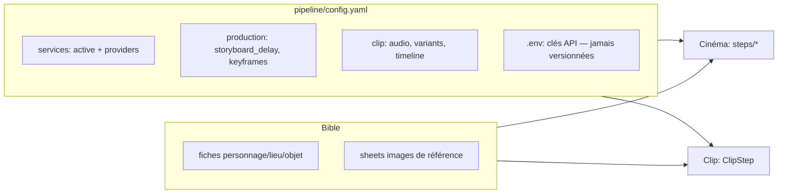

# Architecture

**Dépendances** : aucune.

## Arborescence

```
pipeline/
├── config.py / config.yaml      # chargement + TOUT le paramétrage
├── orchestrator.py              # orchestrateur, checkpoint, resume
├── ztudioz_toolkit.py           # les 25 outils MCP
├── models/
│   ├── bible.py                 # BibleDB, versions, active_version
│   └── scene.py                 # entités scène, timeline
├── services/
│   ├── llm.py                   # LLMService, ToolCallingModel, vision, create_agent
│   ├── image.py                 # ImageService: agnes / pollinations / focus
│   ├── video.py                 # VideoService: agnes local / apihub direct / pollinations
│   ├── audio.py                 # AudioService: TTS say/respond
│   ├── vision.py                # VisionAnalysisService (Albert)
│   ├── consistency.py           # vérification persos / lieux / scènes
│   ├── montage.py               # ffmpeg: assemble_scene / assemble_film
│   └── prompt_builder.py        # templates + ambiance + seeds
├── steps/                       # parse, fiche_step, sheets, storyboard, visualize,
│                                # produce, keyframes_step, audio_step
├── consumption.py               # get_tracker() — appels / tokens / coûts
├── reporter.py                  # progression (step_start / item / end / warn)
├── utils.py                     # upload_to_tmpfiles()
└── clip/                        # steps.py (ClipStep), audio.py (Whisper)
```

Autres points d'entrée : `main.py` (CLI), `run_mcp_server.py` (serveur MCP),
`agents/character_designer.py` (MCP character-designer), `constitution/agents.json` (rôles).

## Responsabilités

**`orchestrator.py`** — `AVAILABLE_STEPS` (`:111`) est la liste des 10 étapes et l'ordre
d'exécution (dont `board`, la planche croquis de validation entre `storyboard` et `visualize`).
`create_project` (`:56`) pose l'arborescence. `write_checkpoint` (`:194`) /
`_get_completed_steps` (`:233`) gèrent la reprise. `resume` rejoue les étapes non faites.

**`models/bible.py`** — BibleDB charge/écrit les `fiche.yaml` par `slug` et `etype` ; la
sous-dossier est `personnage` / `lieu` / `objet` (`:57`). Gère `active_version` et
l'A/B. `models/scene.py` porte les entités de scène, dont la `timeline`.

**`services/*.py`** — un service = un provider actif + une liste de providers, lus dans
`config.yaml`. Repli automatique entre providers. Cache MD5. Voir `ztudioz-providers`.

**`steps/*.py`** — une étape = un checkpoint + une validation humaine. Chaque step lit ses
paramètres dans `config.yaml` (`production.*`).

**`consumption.py`** — `get_tracker()` compte appels / tokens / coûts par étape ; à appeler
si l'on veut savoir ce qu'a coûté un run.

**`reporter.py`** — standardize l'affichage de progression. Les erreurs y sont déjà
converties en avertissements : un run « réussi » peut avoir eu des images qui ont échoué.
Ne pas conclure d'un exit 0 que tout est produit.

## Flux d'information

```mermaid
flowchart TD
    S[scenario.md] --> P1[parse]
    P1 --> P2[fiches]
    P2 --> P3[sheets]
    P3 --> P4[storyboard]
    P4 --> P5[visualize<br/>board + shots]
    P5 --> P6[produce | keyframes]
    P6 --> P7[audio]
    P7 --> M[montage ffmpeg]

    CFG[pipeline/config.yaml<br/>services + production] --> P1
    CFG --> P2
    CFG --> P3
    B[bible/: fiches + sheets] --> P3
    B --> P5
    TL[timeline (parse)] --> P4
```

## Bible + config partagées



## Repli provider (commun aux deux pipelines)

```mermaid
flowchart TD
    G[generate: prompt + refs] --> ACT[provider actif]
    ACT -->|succès| RET[retour cache/chemin]
    ACT -->|échec 402/503/429/5xx/réseau| FB{éligible?}
    FB -->|non, ex. 400 prompt| RAISE[raise]
    FB -->|oui| ORD[get_service_providers_ordered<br/>actif puis backups]
    ORD --> NEXT{backup suivant non tenté ?}
    NEXT -->|oui| BACKUP[service(config=backup)]
    BACKUP --> ACT2[retry]
    ACT2 -->|succès| RET
    ACT2 -->|échec| NEXT
    NEXT -->|non, tous tentés| RAISE
    NAM[garde anti-boucle: set attempted] -.-> NEXT
```

## Pipeline clip — arc-based

`pipeline/clip/` produit un clip musical data-driven, clip-agnostique :
`timeline_v{N}.yaml` → `sections[]` (arc + states) → `beats[]` (1 beat = 1 plan) →
images héro → vidéos par arc → montage sur le MP3.

- **Arc** : les plans d'un même arc se chaînent via `last_frame` ; les arcs sont
  indépendants (prêt pour la production parallèle).
- **Bible à états** : `versions.v1._base` + `states` par état visuel (YAML anchors).
- **Refs** : `_build_concrete_refs()` = `last_frame` + `sheet_perso_état` +
  `sheet_lieu_état`, **max 4** (limite Agnes), troncature intelligente au-delà.
- **Prompt synthesis** : `_synthesize_prompt()` comprime au-delà de la limite du provider
  (agnes 500, pollinations 2000, défaut 1500). Les contraintes critiques restent en premier.
- **Prompts négatifs** : `_build_negative_prompt()` — interdictions génériques + spécifiques
  à la section (« alone » → pas de silhouettes / foule).

## Points d'entrée utiles

```bash
python main.py --help
python main.py status <slug>
grep -n "active:" pipeline/config.yaml
```

## Pièges d'architecture

- `projets/` est **ignoré par git** : aucun filet de sécurité sur les projets.
- `pipeline/steps/scenario.py` existe mais n'est **pas** dans `AVAILABLE_STEPS` : code mort.
- Il n'existe pas d'étape `montage` : `assemble_scene` / `assemble_film` sont des fonctions.
- `board` n'est pas une étape : c'est une sous-pas de `visualize`.
- `bible/ambiance/` n'est pas créé par `init` alors que `prompt_builder` en dépend.
