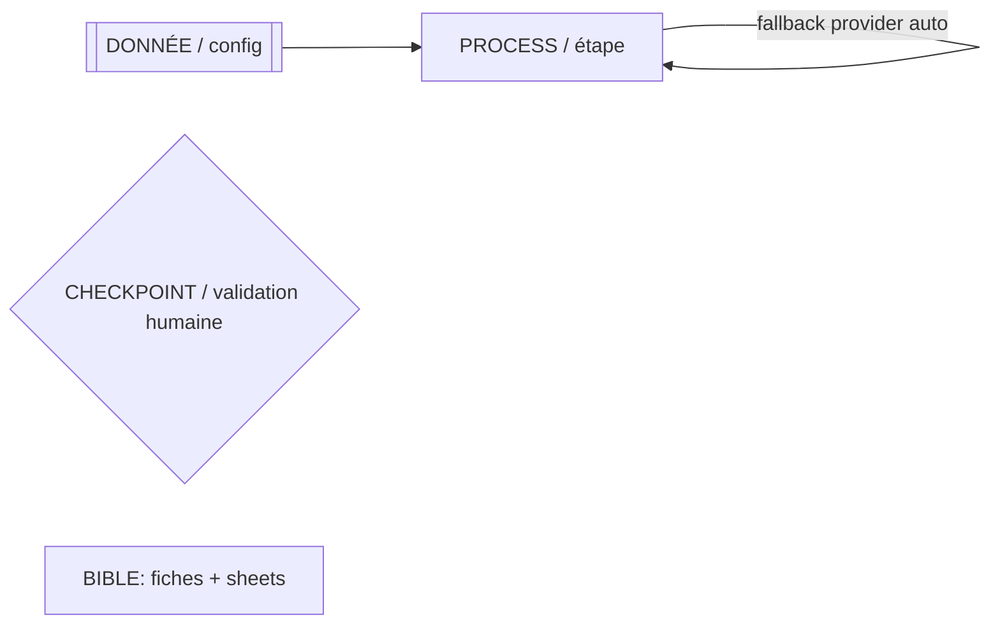
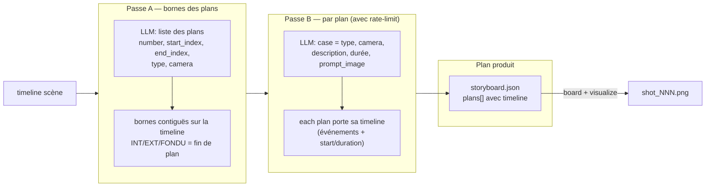
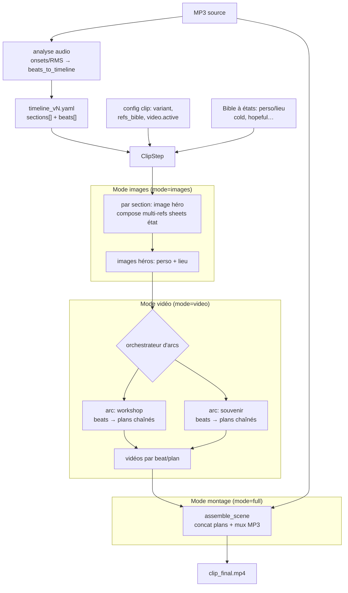
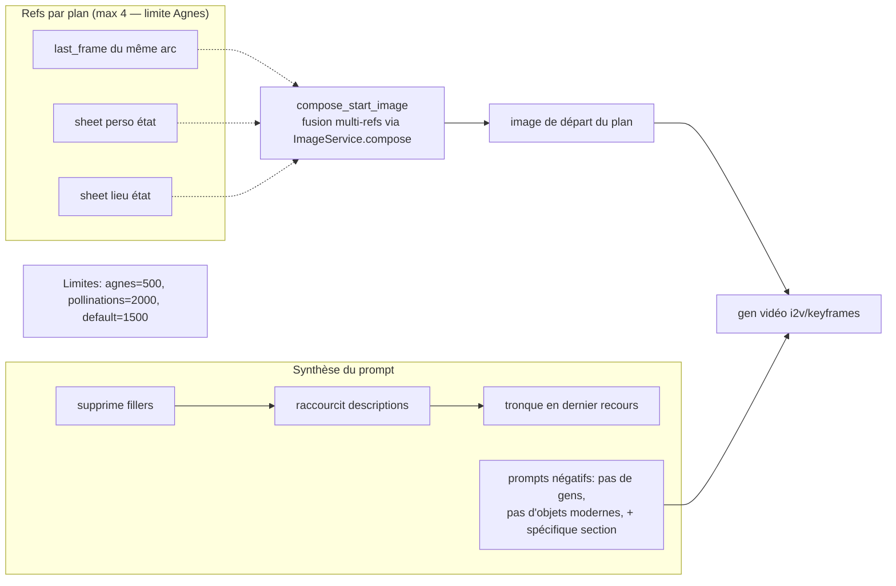
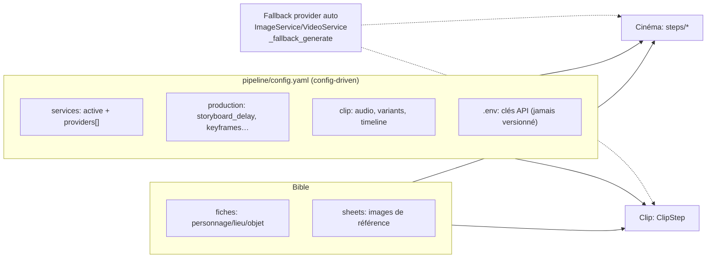
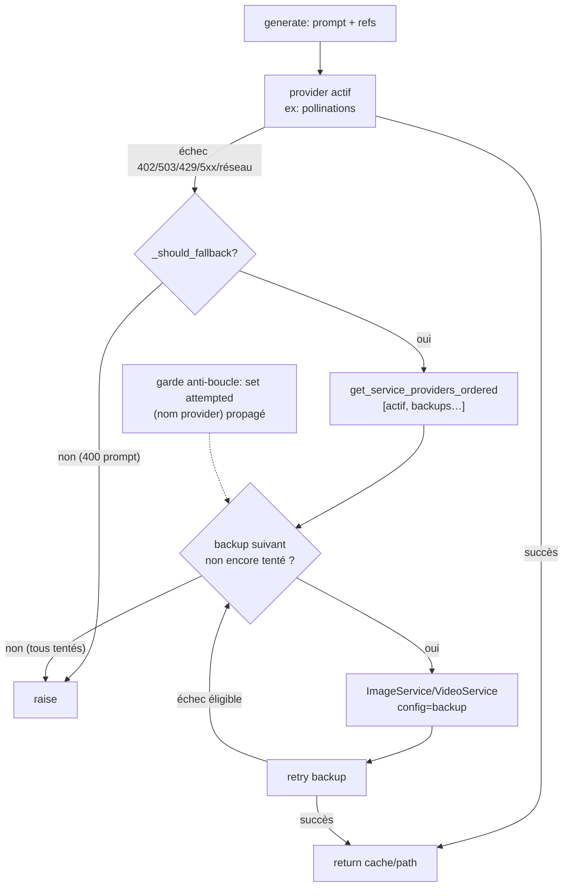
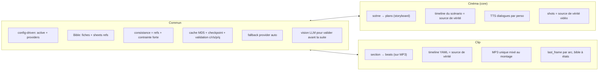

# SCHEMAS — Architecture et flux des deux pipelines ZtudioZ

> Vue **graphique** (Mermaid) des deux approches de production, de leurs flux
> d'information, étapes, processus et de ce qui est **commun**.
> Lecture textuelle complémentaire : `README.md` (vue d'ensemble), `WORKFLOW.md`
> (pipeline cinéma), `METHODE.md` (méthode Wilder), `DOC.md` (inventaire), `AGENTS.md`
> (config/règles), `.agents/skills/ztudioz-clip/SKILL.md` (clip).

Légende récurrente :

---

## 0. Les deux pipelines en un coup d'œil

| | **Cinéma** (le core) | **Clip musical** |
|---|---|---|
| Source narrative | `scenario.md` (scénario) | `timeline_v{N}.yaml` (timeline sur MP3) |
| Unité de découpage | **Scène** → plans (storyboard) | **Section musicale** → beats |
| Rythme | Driven par le drame (Wilder) | Driven par la **musique** (timestamps MP3) |
| Flux | `parse → fiches → sheets → storyboard → board → visualize → produce → audio` | `timeline → sections → beats → images héro → vidéos (par arc) → montage sur MP3` |
| Chaînage visuel | Shot = source de vérité (I2V) | `last_frame` par arc (continuité) |
| Audio | TTS dialogues par personnage | MP3 source unique (mixé au montage) |
| Bible | Objets partagés (fiches + sheets) | Objets **à états** (cold/hopeful…) |

---

## 1. Pipeline Cinéma — cycle Wilder (8 étapes)

Chaque étape écrit un **checkpoint** et s'arrête pour **validation humaine**.
L'ordre est strict : les **sheets** (références) précèdent le storyboard, les **shots** le
suivent, et ne se lancent jamais sans les sheets de la scène.

```mermaid
flowchart TD
    S[scenario.md] --> P1[1. parse]
    P1 --> P2[2. fiches]
    P2 --> P3[3. sheets]
    P3 --> P4[4. storyboard text]
    P4 --> P5[5. board planche]
    P5 --> P6[6. visualize shots]
    P6 --> P7[7. produce vidéo I2V]
    P7 --> P8[8. audio TTS]
    P8 --> M[montage scène/film]

    subgraph BIBLE[Bible partagée]
        B1[fiche.yaml: personnage/lieu/objet]
        B2[sheet_v1.png: image de référence]
        B1 --> B2
    end

    subgraph SOURCE[Source de vérité du scénario]
        TL[parse: timeline ordonnée<br/>actions + dialogues + transitions<br/>entrelacés, avec index/groups]
    end

    P2 -.crée.-> BIBLE
    P3 --"refs (upload tmpfiles 48h)"--> P4
    P3 --> P6
    P4 --"découpage en plans (passes A/B)<br/>--> candidat shot (voir schéma détail)"--> P5
    P6 --"shots = images des plans<br/>avec refs sheets"--> P7
    P7 --"I2V: shot en frame de départ"--> M
    P8 --"voix par personnage (fiche)"--> M

    TL --> P4
```

### Détail du découpage storyboard (2 passes) et du flux d'info par plan

---

## 2. Pipeline Clip — arc-based (data-driven sur MP3)

La **timeline YAML** est la source de vérité temporelle ; le MP3 pilote durée/rythme.
Les **arcs narratifs** sont des équipes de tournage autonomes : les plans d'un même arc se
chaînent via `last_frame`, chaque arc gère sa dernière frame.

### Composition des refs et synthèse de prompt par plan (détail)

---

## 3. Flux d'information commun — la Bible + config partagées

Les **deux** pipelines lisent la même source config (`pipeline/config.yaml`) et la même
**Bible** (fiches + sheets). C'est ce socle commun qui garantit la consistance
personnage/lieu, et que la leçon « refs + contrainte forte » s'applique partout.

---

## 4. Fallback provider — mécanisme commun (hérité du clip V4)

Quand le provider actif renvoie 402/503/429, les **deux** pipelines basculent seuls sur le
provider backup de `config.yaml`, dans l'ordre, **sans boucle** (set `attempted`).

---

## 5. Récapitulatif des points communs / différences

